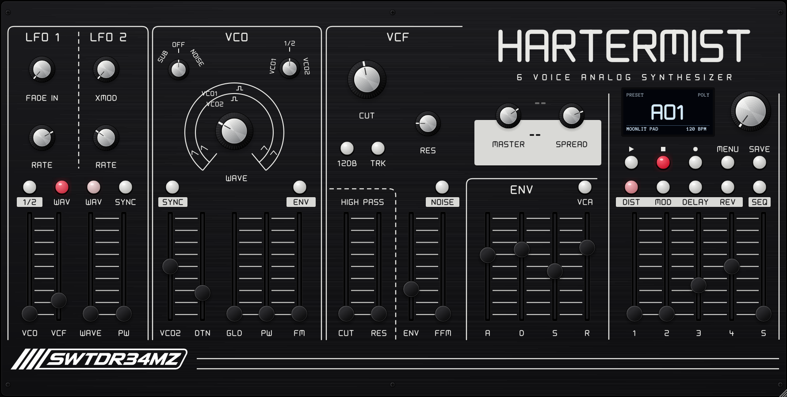

# HARTERMIST

A 6-voice polysynth in the manner of the Dreadbox **Artemis**, as a **VST3** for Windows and the Mac, an **AU** for the
Mac and a **standalone app**. By **swtdr34mz**.



Unofficial: not made, endorsed or supported by Dreadbox. Its own programs, no Artemis presets in it.

## Download

[Actions](https://github.com/swtdr34mz-afk/HARTERMIST/actions) → the newest green run → **Artifacts** at the bottom:
`HARTERMIST-Windows` or `HARTERMIST-macOS` (a GitHub sign-in is needed for artifacts). Releases carry the same zips.

## Installieren (kurz auf Deutsch)

**Windows (Cubase):**
1. Zip entpacken.
2. Den Ordner `HARTERMIST.vst3` nach `C:\Program Files\Common Files\VST3\` kopieren.
3. Cubase starten (oder *Studio → VST-PlugIn-Manager → Aktualisieren*). HARTERMIST steht unter den Instrumenten,
   Hersteller swtdr34mz.
4. `HARTERMIST.exe` ist die Standalone-App. Audio- und MIDI-Gerät stellt man unter *Options* ein.

**Mac (Ableton, Logic, ...):** Am besten die `.tar.gz` nehmen. `HARTERMIST.vst3` nach `~/Library/Audio/Plug-Ins/VST3/`,
`HARTERMIST.component` nach `~/Library/Audio/Plug-Ins/Components/`. Dann einmal im Terminal:
```
xattr -cr ~/Library/Audio/Plug-Ins/VST3/HARTERMIST.vst3 ~/Library/Audio/Plug-Ins/Components/HARTERMIST.component
```

## Bedienung (kurz auf Deutsch)

- **ENV**: Die vier Fader sind die Filter-Hüllkurve (auch für FM mit ENV). **VCA** drücken: die Fader sind die
  Lautstärke-Hüllkurve (VCA leuchtet). VCA lange halten (oder Rechtsklick): eine gemeinsame Hüllkurve für beides (VCA
  blinkt).
- **DIST, MOD, DELAY, REV**: zeigen die Effektseite im Display, die Fader **1–5** stellen sie ein, der **Encoder** wählt
  den Algorithmus. **SEQ**: erst die Seite, die an ist (Arp oder Sequencer), dann die andere, dann zurück. Auf diesen
  Seiten stellt der Encoder das Tempo ein, Encoder drücken schaltet Arp oder Sequencer an und aus.
- **Display** anklicken (oder Encoder drücken): die Programmliste. Encoder drehen: nächstes Programm.
- **▶** startet und pausiert die Uhr, **■** hält sie an, **■ zweimal**: zurück auf Schritt 1, alle Noten aus. Läuft der
  Host, folgt HARTERMIST seinem Tempo und seiner Position (MENU → Global → Clock follows the host).
- **●** (REC): beim Arp hält es die Noten fest (Hold). Beim Sequencer nimmt es auf: Noten spielen, loslassen, nächster
  Schritt. Encoder drücken ohne Tasten: Pause; mit gehaltenen Tasten: Haltebogen (Tie). Encoder drehen: Schritt wählen.
- **MENU**: Play Mode (Poly, Tri, Duo, Unison, Mono), VCO 1 Tune, Drive, Legato, Glide, Preset Level, Instability,
  Delays BPM Sync, Amp Velocity, Pitch Wheel; **Mod Matrix**; Global (MPE, Host-Sync, Qualität); Initialize.
- **Mod Matrix** wie am Artemis: MENU → Mod Matrix → eine Quelle (LFO 1, LFO 2, VCA EG, Filter EG, Velocity, Modwheel,
  Aftertouch, Key Track, CC74). Dann einfach Regler und Fader bewegen: das stellt die Stärke dieser Quelle auf diesem
  Regler ein (−100…+100, ein blauer Bogen zeigt sie). Doppelklick: zurück auf 0. MENU nochmal: fertig.
- **SAVE**: der Sound als eigenes Programm (in `Dokumente/HARTERMIST/Programs`).
- Doppelklick auf einen Regler: Grundwert. Shift beim Ziehen: fein.

## What it has

- **6 voices**; PLAY MODE **POLY**, **TRI** (3 notes of 2 voices), **DUO** (2 of 3), **UNISON** (6 on one note),
  **MONO**; the stacked voices detuned by **DTN**; LEGATO, GLIDE on / AUTO (polyphonic glide).
- Per voice: **two VCOs**, one **WAVE** morphing both from sawtooth through square to triangle, **PW** narrowing both (to
  silence, as the Artemis' PW does), **VCO 2** ±2 octaves in semitones, **DTN** raising it, hard **SYNC** of VCO 2 to
  VCO 1, **through-zero linear FM** of VCO 1 by VCO 2 (or its depth from the filter envelope: **ENV**), **SUB / NOISE**
  (the sub an octave under VCO 1, or white noise), the **VCO 1 / VCO 2** crossfader.
- The **low-pass**: 24 dB of four OTA stages or **12DB**, **RES** to self-oscillation (DRIVE's NO OSC: never),
  **DRIVE** off / low / mid / high, **TRK** zero / half / full, **ENV**, **FFM** (VCO 2 or **NOISE** at audio rate to the
  cutoff). The 12 dB stereo **HIGH PASS** (CUT, RES) after the voices.
- **Two ADSR** (the filter's and FM's, the VCA's, or one shared), **AMP VELOCITY**.
- **Two LFOs per voice**: sine, triangle, saw, ramp, square, random, Env+, Env- (a single cycle a note); **SYNC** free,
  key, BPM, BPM + key (x8 … 1/64 with triplets and dotted); LFO 1 to the VCOs' pitch (**1/2**: VCO 1, VCO 2 or both)
  and the cutoff, with its **FADE IN**; LFO 2 to LFO 1's rate (**XMOD**: ratchets), to the **WAVE** and VCO 1's **PW**.
- **INSTABILITY**: each voice its own small differences in pitch, cutoff, pulse width and envelope times.
- **SPREAD**: voices 1, 3, 5 left, 2, 4, 6 right.
- The **mod matrix**: LFO 1, LFO 2, VCA EG, Filter EG, Velocity, Modwheel, Aftertouch (poly and channel), Key Track,
  CC74 to every knob and slider (and VCO 1 TUNE), −100…+100; per voice, and for the global ones (the high-pass, SPREAD,
  the effects' sliders) their monophonic versions.
- **Four effect pages in series**, stereo:
  - **DIST** (BITS, RATE, GAIN, LEVEL, MIX; at 2x): Exponential, Parabolic, Sine Clip, S-Curve, Soft Clip, Hard Clip,
    Tri Clip, Tri Fold, Single Fold, Multi Fold, Sine Bend, Sine Fold, Sine Shred, Bin Shred, Sym Warp
  - **MOD**: Chorus, Ensemble, Tape Chorus, BBD Chorus, Flanger, BBD Flanger, Thru-Zero Flanger, Phaser, Barber-Pole
    Phaser (DPTH, SPD, FEED, WDTH, MIX), Double Notch (DPTH, SPD, NTCH, WDTH, MIX), Pitch Shifter (L, R, FEED, DAMP,
    MIX), BBD Resonator (TIME, OFST, FEED, SPRD, MIX)
  - **DELAY**: Stereo (L, R, FEED, DAMP, MIX), Ping-Pong (TIME, PAN, FEED, DAMP, MIX), BBD Delay (TIME, FEED, SPD, DPTH,
    MIX), BBD Playground (TIME, OFST, FEED, SPRD, MIX), Random Repeater (SIZE, REP, PROB, EG, MIX); synced to the
    tempo with DELAYS BPM SYNC
  - **REV**: Small, Large (PRE, SIZE, FEED, DAMP, MIX), Huge (SIZE, FEED, SPD, DPTH, MIX), Cloud (TUNE, SIZE, FEED,
    GRAIN, MIX), Shimmer (TUNE, SIZE, FEED, DAMP, MIX)
- The **arpeggiator**: UP, DOWN, ORD, INC, EXC, RND; DIV (1/1 … 1/64 with triplets and dotted), PROB, SWNG (50–75),
  GATE; REC holds.
- The **poly sequencer**: 64 steps of up to six notes, ties and rests, recorded step by step; STEPS, DIV, PROB, SWNG,
  GATE; its place follows the song's (it stays in step when the program changes).
- **MPE** (MENU → Global): each note its own pitch bend (up to 96 semitones), pressure and CC74. Poly aftertouch.
- The voices at 4x the rate (HIGH) or 2x (ECO).
- 38 programs of its own in bank A; your own after them (SAVE).

## Building

```
cmake -B build -DCMAKE_BUILD_TYPE=Release
cmake --build build --config Release
```
JUCE 8 comes from GitHub. The engine's tests: `cmake -S tests -B build-tests && cmake --build build-tests && build-tests/engine_tests`.

## License

MPL-2.0. The fonts: Fira Sans and Anonymous Pro (SIL Open Font License, `fonts/`).
